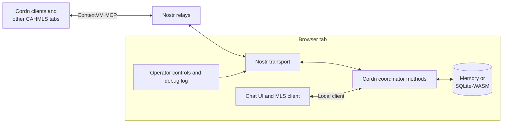

<div align="center">

# CAHMLS

Cordn Ad-Hoc MLS: a ContextVM coordinator and chat interface that runs in a browser tab.

[](https://github.com/sandwichfarm/CAHMLS/actions/workflows/ci.yml)
[](https://github.com/sandwichfarm/CAHMLS/stargazers)


</div>

## What is this?

CAHMLS brings up a temporary [Cordn](https://github.com/Cordn-msg/cordn) MLS coordinator without a backend. The tab receives [ContextVM](https://contextvm.org) MCP requests over Nostr relays, stores group state, and serves Cordn clients until it closes. The same app is also an MLS chat client, so you can host and join rooms from one workspace.

It suits short-lived groups, demos, local testing, and operator-controlled sessions where a tab can stay open for the life of the group. Use a hosted coordinator when availability matters.

## Quick Start

Requires Node.js 22+ and pnpm 10.17.1.

```bash
pnpm install
pnpm dev
```

Open the URL Vite prints (`http://localhost:5173` unless the port is taken). The dev server binds to `0.0.0.0`, so it is also reachable from your local network.

## Features

- **Coordinator:** runs the Cordn method surface in the browser, including streaming group-message subscriptions, and refuses to start a second instance with the same pubkey.
- **Chat:** create and join rooms, with grouped messages, reactions, unread counts, presence, and notifications.
- **Invites:** share a room by link or QR code, or send a direct invitation over Nostr.
- **Identity:** use a persistent, rotatable anonymous identity, a NIP-07 extension, or a NIP-46 remote signer (bunker URI or QR code).
- **Persistence:** optionally encrypt the coordinator key behind a passphrase and keep coordinator data in a SQLite-WASM snapshot. Both are opt-in.
- **Diagnostics:** inspect raw Nostr events, decoded requests, responses, relay publish state, and resource usage.

## How It Works



## Running a Coordinator

1. Open the app and complete first-run setup.
2. Review the relay list. Clients must be able to reach these relays.
3. Start the coordinator.
4. Give Cordn clients the coordinator pubkey, or create a room and share its invite.
5. Watch the debug log if a client does not connect or does not mark messages as sent.

Defaults are announcements off, autostart off, and a limit of 64 users. Runtime configuration locks while the coordinator runs, so stop it before changing relays, announcement mode, or user limits.

### Warnings

> [!WARNING]
> The browser tab is the coordinator. Closing it, refreshing it, or losing network access interrupts coordination. This is not a hardened always-on service.

- **Relay mismatch:** a working coordinator looks offline to clients on different relays.
- **Stale config:** saved browser configuration overrides new app defaults. Edit the relay list directly. Destroying the coordinator also resets configuration, but it deletes the coordinator key and pubkey too.
- **Identity loss:** without encrypted persistence, a fresh browser profile or cleared storage creates a new coordinator pubkey.
- **Duplicate instances:** run one coordinator per pubkey. A second instance should fail with `cordn already running`. If it does not, stop both and restart one.
- **Sensitive logs:** the debug log can show encrypted event metadata and request shapes. Avoid sharing screenshots when coordination details are sensitive.

### Debugging Client Delivery

The debug log traces each request in order:

| Log entry | Meaning |
|-----------|---------|
| `raw nostr event received` | A relay delivered an event to the coordinator. |
| `decoded client request` | The event decrypted and decoded as an MCP request. |
| `disabled_unused_stream` | A non-streaming request carried a progress token, so the coordinator removed the unused stream guard before responding. |
| `outbound coordinator response` | The coordinator produced the MCP response body. |
| `publishing nostr response event` | The response is being published to relays. |
| `nostr response event accepted` | At least one relay accepted the response. |

For a normal message post, the decoded request shows `tool=msg_post` and the response includes `cursor`, `gid`, and `at`.

## Development

| Command | Purpose |
|---------|---------|
| `pnpm lint` | Run ESLint |
| `pnpm exec tsc --noEmit` | Type-check |
| `pnpm test` | Run Vitest unit tests |
| `pnpm test:e2e` | Build, then run Playwright in Chromium (first run: `pnpm exec playwright install chromium`) |
| `pnpm build` | Type-check and build to `dist/` |
| `pnpm run ci` | Run lint, unit tests, SDK checks, docs build, app build, and e2e in sequence |
| `pnpm sdk:coverage` | Run SDK tests with enforced coverage thresholds |
| `pnpm sdk:verify-package` | Build the SDK and load every published entry point |
| `pnpm docs:dev` | Serve the SDK documentation locally |
| `pnpm docs:build` | Build the SDK documentation |
| `pnpm check:upstream` | Compare coordinator methods and schemas with live Cordn upstream |
| `pnpm test:upstream-interop` | Run a pinned upstream Cordn client against CAHMLS's real transport |

Use `pnpm run ci`, not `pnpm ci`, which is a reserved pnpm command that fails. The build may print upstream Rolldown warnings from dependency pure annotations. They are currently non-fatal.

### Project Structure

```
.github/workflows/    CI and nsite deploy
.nsite/               nsyte site configuration
.planning/            GSD requirements, roadmap, and phase records
docs/                 VitePress documentation for the SDK
packages/sdk/         @cahmls/sdk: framework-free coordinator and client
├── src/client/       Room sessions, MLS protocol, invites, coordinator clients
├── src/contracts/    Cordn method names and schemas
├── src/coordinator/  Delivery service and storage
├── src/crypto/       Coordinator keys and signer
├── src/mls/          KeyPackage and Welcome codecs
├── src/relay/        Bounded relay pool
├── src/runtime/      Coordinator lifecycle and instance guard
├── src/server/       ContextVM methods and transport
└── tests/            SDK tests
scripts/              Upstream checks and deploy secret setup
src/
├── chat/             Room navigation, sidebar ledger, message presentation
├── components/       Svelte 5 UI
├── config/           Relay and runtime configuration
├── coordinator/      Svelte bindings over the SDK runtime, resource monitor
├── identity/         Anonymous, NIP-07, and NIP-46 identities
├── invites/          Nostr social data
├── lib/              Viewport overlay
├── navigation/       Workspace routing
├── notifications/    Notification center and channel preferences
└── shims/            Browser shims for Node modules
tests/
├── e2e/              Playwright specs
└── unit/             Application tests
```

## Deployment

After CI passes on `main` or `master`, the deploy workflow publishes `dist/` to Nostr and Blossom with [nsyte](https://nsyte.run). It skips the deploy if the required secrets are not set.

Configure repository secrets with GitHub CLI authenticated:

```bash
./scripts/setup-secrets.sh
```

The script prompts for:

| Secret | Value |
|--------|-------|
| `NBUNK_SECRET` | The `nbunksec1...` credential from `nsyte ci` |
| `NSYTE_RELAYS` | Comma-separated Nostr relay URLs |
| `BLOSSOM_SERVER_URLS` | Comma-separated Blossom server URLs |
| `NSITE_NAME` | Optional named nsite. Leave empty for the root npub site. |

## Documentation

| Resource | Description |
|----------|-------------|
| [SDK documentation](docs/guide/getting-started.md) | Guides and API reference for `@cahmls/sdk`; run `pnpm docs:dev` to browse |
| [AGENTS.md](AGENTS.md) | Delivery lifecycle, quality gates, and Cordn interoperability guardrails |
| [GIT-PROCEDURES.md](GIT-PROCEDURES.md) | Branch, commit, and pull request procedure |
| [.planning/PROJECT.md](.planning/PROJECT.md) | Project scope, context, and decisions |
| [.planning/ROADMAP.md](.planning/ROADMAP.md) | Milestones and phases |

## Contributing

Work on a feature branch and open a pull request against `master`. Follow [GIT-PROCEDURES.md](GIT-PROCEDURES.md) and run the gates in [AGENTS.md](AGENTS.md). Changes to `src/cordn/`, coordinator contracts, or chat admission and wire-protocol paths must also pass `pnpm check:upstream` and `pnpm test:upstream-interop`.

<a href="https://github.com/sandwichfarm/CAHMLS/graphs/contributors">
  
</a>

---

<div align="center">

[](https://star-history.com/#sandwichfarm/CAHMLS&Date)

</div>
